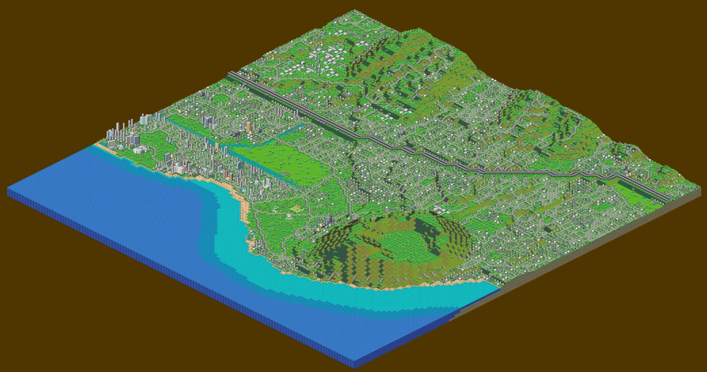

# SimCity 2000: Honolulu

Waikiki, Diamond Head and the neighbourhoods behind them, rebuilt as a SimCity 2000 city, with a custom tropical
tile set. Every colour on screen is a real Perler bead, because the city is also the pattern for a Perler bead
piece.



## What's in it

- **The city** (`WAIKIKI.SC2`): a 128×128 map built from OpenStreetMap and USGS elevation data.
  - Waikiki's hotels and condos, Kapiʻolani Park with the zoo, the Waikiki Shell and the aquarium, the
    Ala Wai Canal, UH Mānoa, the H-1 freeway, Kaimuki and Kapahulu.
  - An exaggerated Diamond Head.
  - A three-colour sea: turquoise reef, teal-blue drop-off, deep azure.
- **The diorama tile set** (`WAIKIKI.MIF`): hand-modelled landmarks.
  - The pink Royal Hawaiian with its domed bell tower.
  - The white Moana Surfrider with its banyan.
  - St. Augustine by the Sea, and the Hawaiian homes.
  - Pastel towers, palm-lined streets, green lots and tropical water, all drawn in SimCity 2000's pixel-art
    style.
- **The play tile set** (`TROPICAL.MIF`, or `TROPSTK.MIF` for an unpatched game): the same tropical look
  for *any* city you play.
  - Palms and shade trees, flower- and tree-lined roads, green land and Hawaiian homes.
  - The game's own buildings recoloured in soft pastels on green lots.
  - Every building is still what the game says it is, so cities grow normally.
- **A bead palette**: the game's 256-colour palette rebuilt from the 124 Perler bead colours.
  - Each palette entry keeps as close to its original colour as beads allow, so the menus and stock art still
    look like SimCity 2000.
- **The tools** (`tools/`) that build all of this from the map data and from your own copy of the game.

The repository contains no game files. The tile sets reuse and recolour the game's own sprites. Prebuilt copies
are in [`dist/`](dist), and the installer can also build them from your installed copy.

## What you need

- **SimCity 2000 Special Edition for Windows 95** (the CD version, or another copy with `SIMCITY.EXE`,
  `DATA/LARGE.DAT` and `SCURKART/`). The GOG release is the DOS version and won't work.
- **[sc2kfix](https://github.com/sc2kfix/sc2kfix)** (tested with Release 11b). It loads the extra sprites that
  replace the terrain, water and trees.
- **Python 3.11 or later.**

```bash
python -m venv .venv
.venv/Scripts/pip install -r requirements.txt
```

## Installing

Close the game first. The installer patches two game files (backing each up to `*.orig` the first time), builds
the city and both tile sets, and copies them into the game folder.

### Option 1: the Waikiki diorama

```bash
.venv/Scripts/python tools/install.py "C:/Games/SC2K"
```

1. Start the game with the city:

   ```powershell
   SIMCITY.EXE "C:\Games\SC2K\CITIES\WAIKIKI.SC2"
   ```

   Start it from the game folder, so sc2kfix loads.
2. Load `SCURKART\WAIKIKI.MIF` from the game's tile-set menu. The tile set isn't saved with the city, so load
   it each session.
3. Keep the default rotation (ocean at the bottom) and keep the city paused.

The diorama is a model, not a working city: nothing is powered, and running the simulation will knock buildings
down and redevelop them. To show the landmarks, the diorama tile set redraws some of the game's own slots:

- Industry shows hotels and parks.
- Rubble shows beach towels.
- Radiation shows reef water.

### Option 2: play any city in the tropical style

```bash
.venv/Scripts/python tools/install.py "C:/Games/SC2K" --play
```

Open or start any city, then load `SCURKART\TROPICAL.MIF` from the tile-set menu. (`TROPSTK.MIF` is installed
too, but it's for an unpatched game: with the bead palette its colours are wrong.)

### Quick install, no patching: TROPSTK.MIF

The simplest way to try the tropical look is `dist/TROPSTK.MIF`, a version of the play tile set drawn in the
game's own palette:

1. Copy `dist/TROPSTK.MIF` into the game's `SCURKART` folder.
2. Open any city and load `TROPSTK.MIF` from the tile-set menu.

It needs no patch, no Python and no build, only sc2kfix (which loads the terrain, water and tree sprites).
Because it uses the game's palette rather than beads, its colours are a little stronger: brick comes out coral
rather than pink, and lawns a slightly yellower green.

It needs the game's original palette and terrain table. If you've run the installer or `patch_game.py`,
undo that first with `install.py --restore`.

### Quick install of the bead-palette play set: TROPICAL.MIF

`dist/TROPICAL.MIF` is the same set in Perler bead colours. Copy it into `SCURKART`, then apply the bead
palette and play mode, with the game closed:

```bash
.venv/Scripts/python tools/patch_game.py "C:/Games/SC2K" --play
```

Without that palette its colours are wrong: some pink buildings turn bright blue.

`dist/WAIKIKI.MIF` is there too, but the diorama also needs the city, `WAIKIKI.SC2`, which the installer
builds. It also needs the bead palette.

### Switching between the two

Both options install both tile sets. They differ only in how the game draws water, which is set in
`SIMCITY.EXE`:

```bash
.venv/Scripts/python tools/patch_game.py "C:/Games/SC2K"          # diorama mode
.venv/Scripts/python tools/patch_game.py "C:/Games/SC2K" --play   # play mode
```

- **Diorama mode** draws the reef and the canal from sprite slots that `TROPICAL.MIF` uses for radiation, the
  marina and the Forest Arcology. Shallow sea in other cities would look radioactive.
- **Play mode** gives Waikiki a plain single-colour sea.

### Just the palette, or nothing at all

- **Palette:** the bead palette (`BITMAPS/PAL_MSTR.BMP`) is applied in both modes. It changes colours across
  the game, menus included, but stays close to the original.
- **Without a tile set loaded:** in either mode, stock sprites show some shifted colours, because each tile
  set carries corrected copies of them.
- **To undo everything:**

  ```bash
  .venv/Scripts/python tools/install.py "C:/Games/SC2K" --restore
  ```

  This restores both game files from their `*.orig` backups. The copied city and tile sets stay in the game
  folder, but do nothing unless you load them.

Keep `weather_effects` set to `false` in `settings.json` (sc2kfix's settings) while viewing the diorama.

## Rebuilding after changes

```bash
.venv/Scripts/python tools/geo.py                                   # only after changing the map frame or OSM data
.venv/Scripts/python tools/patch_game.py "C:/Games/SC2K"            # after palette or water-table changes
.venv/Scripts/python tools/make_all.py "C:/Games/SC2K"              # city, sprites, checks, WAIKIKI.MIF
.venv/Scripts/python tools/play_tileset.py "C:/Games/SC2K"          # TROPICAL.MIF and TROPSTK.MIF
.venv/Scripts/python tools/preview_game.py "C:/Games/SC2K"          # render the city as the game draws it
.venv/Scripts/python tools/check_beads.py                           # every pixel must be a Perler bead
```

Outputs go to `build/`. Copy `WAIKIKI.SC2` to the game's `CITIES/` and the `.MIF` files to `SCURKART/`, or rerun
the installer. See [docs/TECHNICAL.md](docs/TECHNICAL.md) for how the map, sprites, tile sets and patches work.

## Credits

- Map data © OpenStreetMap contributors, [ODbL](https://opendatacommons.org/licenses/odbl/). Elevation: USGS
  NED 1/3″ via OpenTopoData.
- Bead colours from the [pixel-beads.com Perler chart](https://www.pixel-beads.com/perler-bead-color-chart).
- File formats from [dfloer/SC2k-docs](https://github.com/dfloer/SC2k-docs),
  [OpenCity2k/SC2k-docs](https://github.com/OpenCity2k/SC2k-docs) and [OpenSC2K](https://github.com/OpenSC2K/OpenSC2K).
- SimCity 2000 is © Maxis / Electronic Arts. This project is unofficial. The tile sets in `dist/` contain
  recoloured versions of the game's own sprites; no game files themselves are included.
